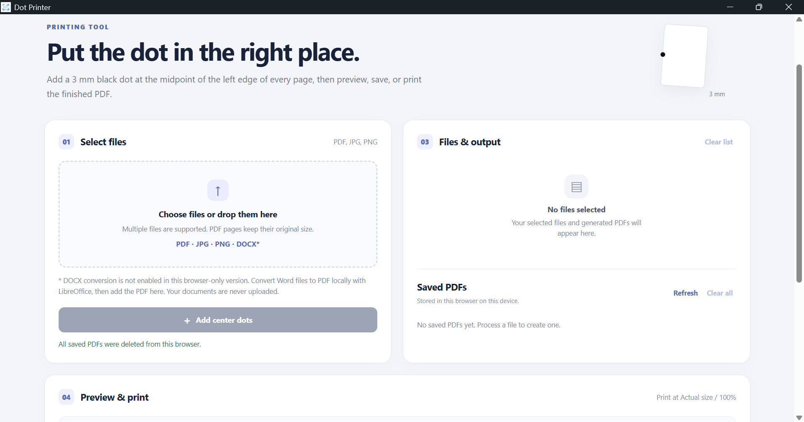
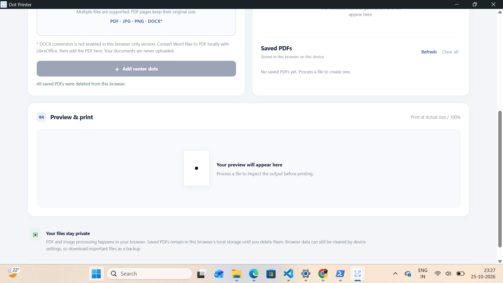

# Dot Printer

**Dot Printer** is a lightweight Windows desktop application that adds a small dot to the midpoint of the left edge of a page, helping you find a reference point for folding, punching, or binding printed documents.

## Features

- Add a dot at the midpoint of the left page edge.
- Set the dot diameter to 3 mm.
- Process PDF files locally.
- Preview and prepare documents for printing.
- Designed to work offline after installation, subject to the features and dependencies used.
- Windows desktop application built with Electron and Vite.

## Screenshots

### Main application



### Preview and print



## Download

Download the latest Windows installer from [Dot Printer GitHub Releases](https://github.com/lalit-cosmo/dot-printer/releases/latest).

## Install on Windows

1. Open the [latest release](https://github.com/lalit-cosmo/dot-printer/releases/latest).
2. Under **Assets**, download `Dot Printer Setup 0.1.1.exe`.
3. Run the installer and follow the setup instructions.
4. Open Dot Printer from the Start menu or desktop shortcut, if created.

### Windows security notice

This installer is currently unsigned. Windows Smart App Control or other Windows security features may block it. Do not disable Windows security to install it. A future release may use an appropriate trusted signing or Microsoft Store distribution route.

## Run from source

### Requirements

- Node.js and npm
- Git

### Setup

```powershell
git clone https://github.com/lalit-cosmo/dot-printer.git
cd dot-printer
npm install
```

### Start the development version

Open two terminal windows in the project directory.

Terminal 1:

```powershell
npm run dev
```

Terminal 2:

```powershell
npm run dev:electron
```

### Build the Windows installer

```powershell
npm run dist
```

The generated installer is placed in the `release` directory.

## Privacy

Document processing is intended to happen locally on your computer. Verify the behavior of the features you use before processing sensitive documents.

## Project status

Dot Printer is under active development. Features and supported document formats may change between versions.

## License

No open-source license has been specified yet. All rights reserved unless a license is added to this repository.
